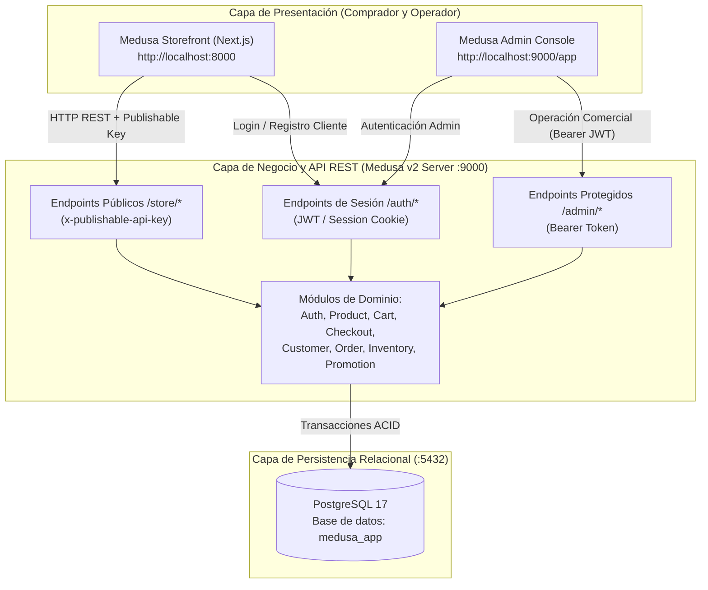

# Descripción Técnica y Arquitectura del Sistema Bajo Prueba (Medusa)

## 1. Visión General del Sistema Elegido

El sistema bajo prueba (SUT, por sus siglas en inglés *System Under Test*) corresponde a **Medusa v2**, una plataforma de comercio electrónico de arquitectura *headless* (desacoplada) y modular desarrollada en **TypeScript** sobre **Node.js**. A diferencia de un prototipo estático o una aplicación monolítica acoplada, el entorno evaluado por el equipo de Aseguramiento de Calidad (QA) opera como un ecosistema transaccional completo desplegado en entorno local real, integrado por tres capas independientes que se comunican mediante servicios HTTP/REST y persistencia relacional en **PostgreSQL 17**.

Esta arquitectura permite validar no solo el comportamiento visual de las interfaces de usuario, sino también la integridad transaccional extremo a extremo (E2E) cuando un operador modifica catálogo, inventario, órdenes o promociones en el panel administrativo y dichos cambios impactan en tiempo real la experiencia de compra del cliente final.

---

## 2. Arquitectura Multicapa en Entorno Real

El despliegue del sistema en el ambiente de pruebas se compone de tres subsistemas activos de manera simultánea:

1. **Capa de Presentación Pública (Medusa Storefront — `http://localhost:8000`):** Aplicación web construida con **Next.js** (App Router y Server Actions) orientada al comprador final. Consume los endpoints públicos `/store/*` autenticándose mediante la cabecera `x-publishable-api-key` asociada al canal de ventas por defecto (*Default Sales Channel*).
2. **Capa de Operación Comercial y Servicios REST (Medusa Admin y Backend — `http://localhost:9000/app` y `http://localhost:9000`):** Consola administrativa SPA (*Single Page Application*) servida junto al núcleo transaccional de Medusa. Gestiona autenticación de operadores mediante tokens JWT (`/auth/user/emailpass`) y expone los endpoints protegidos `/admin/*` para la administración de productos, variantes, órdenes, ubicaciones de inventario y reglas promocionales.
3. **Capa de Persistencia Relacional (PostgreSQL 17 — `localhost:5432`):** Motor de base de datos relacional (instancia `postgresql-x64-17`, base de datos `medusa_app`) donde se almacenan con integridad referencial las entidades de dominio del comercio electrónico.

---

## 3. Módulos Funcionales de Comercio Evaluados

El alcance técnico del ciclo de pruebas se estructuró sobre nueve módulos funcionales de Medusa, distribuidos entre el Storefront público y la consola Admin, cubriendo las diez historias de usuario (`HU-01` a `HU-10`) definidas en la matriz de trazabilidad.

**Tabla 1**

*Distribución arquitectónica de los nueve módulos funcionales evaluados en Medusa*

| Código | Módulo Funcional | Superficie Principal | Historia Cubierta | Responsabilidad en el Sistema Bajo Prueba | Casos Asociados |
| --- | --- | --- | --- | --- | :---: |
| `AUTH` | Autenticación y Control de Acceso | Storefront y Admin | `HU-01`, `HU-02` | Registro de clientes, inicio/cierre de sesión y protección de rutas administrativas `/admin/*` | 5 (`CP-AUTH-01` a `05`) |
| `CAT` | Catálogo y Variantes | Storefront | `HU-03` | Renderizado de productos publicados, filtrado por colecciones, búsqueda y selección de tallas/colores | 5 (`CP-CAT-01` a `05`) |
| `CAR` | Carrito de Compras | Storefront | `HU-04` | Creación de carrito por región, adición de SKUs, consolidación de líneas y recálculo de subtotales | 5 (`CP-CAR-01` a `05`) |
| `CHK` | Flujo de Checkout | Storefront | `HU-05` | Captura y validación de dirección de envío, método de entrega, pago de prueba y generación de orden | 6 (`CP-CHK-01` a `06`) |
| `CUS` | Gestión de Cuenta de Cliente | Storefront | `HU-06` | Consulta de historial de órdenes del comprador, libreta de direcciones y edición de perfil | 4 (`CP-CUS-01` a `04`) |
| `PRD` | Administración de Productos | Admin | `HU-07` | Creación de productos, configuración de variantes y precios, transición `Draft -> Published` y eliminación | 6 (`CP-PRD-01` a `06`) |
| `ORD` | Gestión de Órdenes | Admin | `HU-08` | Inspección de pedidos generados en Storefront, despacho (*fulfillment*), cancelación y consistencia fiscal | 6 (`CP-ORD-01` a `06`) |
| `INV` | Control de Inventario | Admin | `HU-09` | Ajuste de existencias por ubicación de almacén, validación de bordes de stock y bloqueo por agotamiento | 4 (`CP-INV-01` a `04`) |
| `PRM` | Promociones y Descuentos | Admin y Storefront | `HU-10` | Definición de campañas porcentuales, activación/inactivación y redención de cupones en carrito | 4 (`CP-PRM-01` a `04`) |

*Nota.* Fuente: Elaboración propia a partir de la arquitectura modular de Medusa v2 y la matriz de casos del repositorio `JuanZ14-Dev/medusa-qa`.

---

## 4. Contratos de Integración y Endpoints REST Verificados

Las pruebas automatizadas de integración y sistema desarrolladas en Playwright combinan la interacción sobre el DOM con peticiones directas mediante `APIRequestContext`, verificando la coherencia entre el estado reportado por la interfaz gráfica y la respuesta JSON del servidor.

**Tabla 2**

*Principales endpoints REST de Medusa evaluados durante las pruebas de integración UI/API*

| Ruta HTTP / Endpoint | Método | Mecanismo de Autenticación | Propósito Técnico en la Verificación QA | Casos de Prueba Vinculados |
| --- | --- | --- | --- | --- |
| `/auth/user/emailpass` | `POST` | Credenciales JSON (`email`, `password`) | Obtención de token JWT para sesión administrativa y validación de rechazo `401 Unauthorized` | `CP-AUTH-04`, `CP-AUTH-05` |
| `/store/products` | `GET` | Header `x-publishable-api-key` | Consulta del catálogo público publicado y cruce de conteo/títulos contra la grilla del Storefront | `CP-CAT-03`, `CP-PRD-04` |
| `/store/carts` y `/store/orders` | `POST` / `GET` | Header `x-publishable-api-key` | Verificación de persistencia de líneas de carrito, aplicación de descuentos y confirmación de orden | `CP-CHK-06`, `CP-PRM-03` |
| `/admin/products` | `GET` / `POST` / `DELETE` | Header `Authorization: Bearer <token>` | Creación, edición de precios, validación de bloqueo sin sesión y baja lógica de productos | `CP-AUTH-05`, `CP-PRD-03` a `06` |
| `/admin/orders` | `GET` | Header `Authorization: Bearer <token>` | Auditoría de totales, subtotales, impuestos y estados de pago/despacho de órdenes reales | `CP-ORD-04`, `CP-ORD-05`, `CP-ORD-06` |
| `/admin/inventory-items` | `GET` / `POST` | Header `Authorization: Bearer <token>` | Inspección y ajuste de niveles de stock (`stocked_quantity`) por ubicación de almacén | `CP-INV-02`, `CP-INV-03`, `CP-INV-04` |
| `/admin/promotions` | `GET` / `POST` | Header `Authorization: Bearer <token>` | Creación y validación de reglas de descuento porcentual y códigos promocionales | `CP-PRM-03`, `CP-PRM-04` |

*Nota.* Fuente: Implementación de clientes HTTP en `tests/helpers/api-client.ts` y especificaciones de prueba en `tests/storefront/` y `tests/admin/`.

---

## 5. Configuración del Entorno Real y Datos Semilla

Para garantizar la reproducibilidad determinista de los 45 casos de prueba, la base de datos `medusa_app` en PostgreSQL 17 se inicializó con el conjunto oficial de datos semilla de Medusa v2, una región europea activa (`dk` / Dinamarca, moneda `EUR`) y cuentas dedicadas para las pruebas de cliente y administrador.

**Tabla 3**

*Parámetros de configuración e inventario semilla del entorno real bajo prueba*

| Componente / Entidad | Parámetro o Identificador | Valor Configurado en el Entorno QA | Uso en el Ciclo de Pruebas |
| --- | --- | --- | --- |
| **Storefront URL** | `STOREFRONT_URL` | `http://localhost:8000` (Ruta regional `/dk/*`) | Ejecución de 22 casos de prueba de superficie Storefront |
| **Admin Console URL** | `ADMIN_URL` | `http://localhost:9000/app` | Ejecución de 23 casos de prueba de superficie Admin |
| **Backend API URL** | `MEDUSA_BACKEND_URL` | `http://localhost:9000` | Validaciones de integración HTTP en Playwright |
| **Base de Datos** | Servicio PostgreSQL 17 | `postgresql-x64-17` (`localhost:5432`, BD `medusa_app`) | Persistencia relacional de catálogo, clientes, carritos y órdenes |
| **Región y Moneda** | `DEFAULT_REGION` | Región `Europe` (`dk`), Moneda `EUR` | Cálculo de precios, impuestos y métodos de envío estándar/exprés |
| **Catálogo Semilla** | Productos iniciales | `Medusa T-Shirt`, `Medusa Sweatshirt`, `Medusa Sweatpants`, `Medusa Shorts` | Flujos de exploración (`CAT`), carrito (`CAR`) y checkout (`CHK`) |
| **Almacén Semilla** | Ubicación de inventario | `European Warehouse` | Ajustes de stock manuales y automatizados (`CP-INV-01` a `04`) |
| **Credencial Admin** | `ADMIN_EMAIL` | `admin@medusa-test.com` | Autenticación en consola Admin y emisión de tokens Bearer |

*Nota.* Fuente: Configuración verificada en `.env.example`, `tests/fixtures/env.fixture.ts` y actas de ejecución del 19/11/2026.
