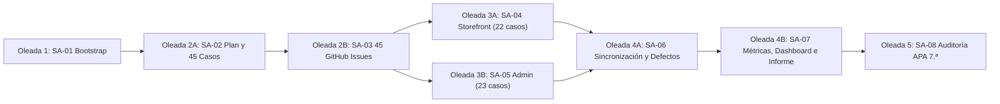

# Dashboard Visual de Métricas de Calidad

Este tablero presenta los indicadores clave de rendimiento (KPI) calculados a partir de la ejecución real de los 45 casos de prueba (18 manuales y 27 automatizados) sobre **Medusa Storefront (`http://localhost:8000`)** y **Medusa Admin (`http://localhost:9000/app`)**, en correspondencia con la Sección 13 del Plan de Pruebas y los registros en GitHub Issues.

<link rel="stylesheet" href="./assets/css/custom.css">

  
<canvas id="chart-modules"></canvas>

  
<canvas id="chart-surfaces"></canvas>

**Tabla 1**

*Indicadores clave de calidad consolidados (Sección 13)*

| Métrica | Fórmula / Medición | Meta | Valor Actual | Estado |
| --- | --- | --- | --- | --- |
| Tasa de ejecución de casos | `(45 / 45) x 100` | >= 95 % | 100 % | Cumplido |
| Tasa de casos aprobados | `(45 / 45) x 100` | >= 90 % | 100 % | Cumplido |
| Densidad de defectos | `0 / 45` | < 0.1 | 0.00 | Cumplido |
| Defectos críticos abiertos | `Conteo de defectos críticos sin resolver` | = 0 | 0 | Cumplido |
| Tasa de reapertura de defectos | `(0 / 0) x 100` | < 5 % | 0 % | Cumplido |
| Cobertura de requisitos | `(10 / 10) x 100` | 100 % | 100 % | Cumplido |

*Nota.* Datos fuente generados automáticamente en [`docs/assets/data/metrics.json`](./assets/data/metrics.json).

## Arquitectura de Ejecución Multiagente

