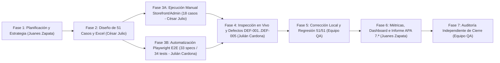

# Dashboard Visual de Métricas de Calidad

Este tablero presenta los indicadores clave de rendimiento (KPI) calculados a partir de la ejecución real de los 51 casos de prueba (18 manuales y 33 automatizados / 34 pruebas en Playwright) sobre **Medusa Storefront (`http://localhost:8000`)** y **Medusa Admin (`http://localhost:9000/app`)**, en correspondencia con la Sección 13 del Plan de Pruebas y el seguimiento exclusivo de defectos `DEF-*` en GitHub Issues.

<link rel="stylesheet" href="./assets/css/custom.css">

  
<canvas id="chart-modules"></canvas>

  
<canvas id="chart-surfaces"></canvas>

**Tabla 1**

*Indicadores clave de calidad consolidados (Sección 13)*

| Métrica | Fórmula / Medición | Meta | Valor Actual | Estado |
| --- | --- | --- | --- | --- |
| Tasa de ejecución de casos | `(51 / 51) x 100` | >= 95 % | 100 % | Cumplido |
| Tasa de casos aprobados | `(51 / 51) x 100` | >= 90 % | 100 % | Cumplido |
| Densidad de defectos | `5 / 51` | < 0.1 | 0.0980 | Cumplido |
| Defectos críticos abiertos | `Conteo de defectos críticos sin resolver` | = 0 | 0 | Cumplido |
| Tasa de reapertura de defectos | `(0 / 5) x 100` | < 5 % | 0 % | Cumplido |
| Cobertura de requisitos | `(10 / 10) x 100` | 100 % | 100 % | Cumplido |

*Nota.* Datos fuente generados automáticamente en [`docs/assets/data/metrics.json`](./assets/data/metrics.json). También puede consultarse el tablero interactivo con segmentadores de datos y gráficos dinámicos en la hoja `Dashboard` de [`casos-de-prueba-medusa.xlsx`](https://github.com/JuanZ14-Dev/medusa-qa/blob/main/casos-de-prueba/casos-de-prueba-medusa.xlsx).

## Flujo del Ciclo de Pruebas QA

