# Catálogo de Evidencias Visuales de Ejecución Manual y Defectos (Storefront y Admin)

## 1. Propósito del Catálogo Documental

El presente anexo consolida las **27 capturas de pantalla reales** recolectadas durante el ciclo de pruebas de los **51 casos totales** (`18` manuales y `33` automatizados en Playwright): `9` capturas de ejecución manual en Medusa Storefront (`http://localhost:8000`), `13` capturas de los 9 casos manuales en Medusa Admin (`http://localhost:9000/app`) y `5` capturas reales de los defectos `DEF-001` a `DEF-005` (`#46`–`#50`) en `docs/evidencias/defectos/`. Cada evidencia respalda las fichas de 16 campos ubicadas en `casos-de-prueba/manuales/`, el libro Excel oficial (`casos-de-prueba/casos-de-prueba-medusa.xlsx`) y los reportes exclusivos de defectos en GitHub Issues de `JuanZ14-Dev/medusa-qa`.

---

## 2. Evidencias de Medusa Storefront (`http://localhost:8000`)

**Tabla 1**

*Registro de evidencias visuales de los nueve casos manuales ejecutados en Storefront*

| ID del Caso | Historia | Escenario Evaluado | Archivo de Evidencia | Responsable | Estado |
| --- | --- | --- | --- | --- | :---: |
| `CP-AUTH-01` | `HU-01` | Registro exitoso de nuevo cliente (`Laura Gomez`) y redirección a `/dk/account` | `evidencias/storefront/CP-AUTH-01.png` | César Julio (QA Analyst) | Pasó |
| `CP-CAT-01` | `HU-03` | Navegación y visualización de detalle de producto en Storefront | `evidencias/storefront/CP-CAT-01.png` | César Julio (QA Analyst) | Pasó |
| `CP-CAT-02` | `HU-03` | Selección de variantes (talla y color) y actualización dinámica de precio | `evidencias/storefront/CP-CAT-02.png` | César Julio (QA Analyst) | Pasó |
| `CP-CAR-01` | `HU-04` | Adición de producto al carrito y persistencia de sesión tras recarga | `evidencias/storefront/CP-CAR-01.png` | César Julio (QA Analyst) | Pasó |
| `CP-CAR-02` | `HU-04` | Eliminación de ítem del carrito y recálculo de subtotal a cero | `evidencias/storefront/CP-CAR-02.png` | César Julio (QA Analyst) | Pasó |
| `CP-CHK-01` | `HU-05` | Flujo completo de checkout hasta pantalla de confirmación de orden | `evidencias/storefront/CP-CHK-01.png` | César Julio (QA Analyst) | Pasó |
| `CP-CHK-02` | `HU-05` | Validación de campos obligatorios vacíos en formulario de dirección de envío | `evidencias/storefront/CP-CHK-02.png` | César Julio (QA Analyst) | Pasó |
| `CP-CUS-01` | `HU-06` | Consulta de historial de órdenes confirmadas en el perfil del cliente | `evidencias/storefront/CP-CUS-01.png` | César Julio (QA Analyst) | Pasó |
| `CP-CUS-02` | `HU-06` | Registro y actualización de dirección de envío en libreta del cliente | `evidencias/storefront/CP-CUS-02.png` | César Julio (QA Analyst) | Pasó |

*Nota.* Fuente: Capturas obtenidas por César Julio (QA Analyst) durante la ejecución funcional en vivo sobre `http://localhost:8000` (trazabilidad en libro Excel y `casos-de-prueba/manuales/storefront/`).

### 2.1 Galería de Capturas Storefront

#### CP-AUTH-01 — Registro exitoso de nuevo cliente en Storefront
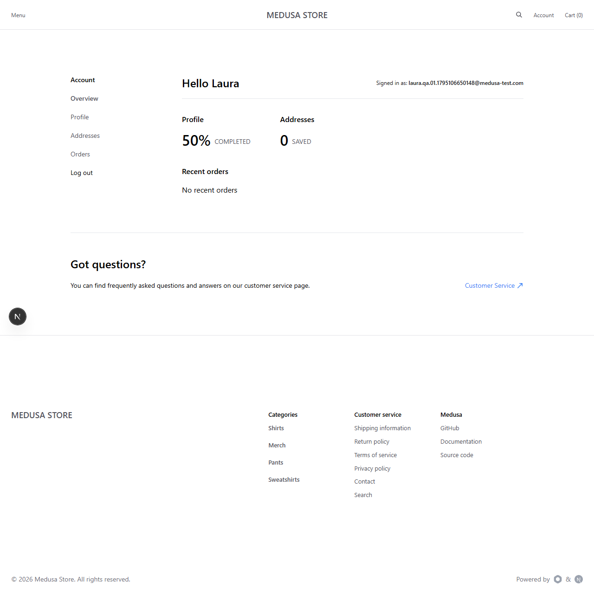

#### CP-CAT-01 — Navegación y visualización de detalle de producto en Storefront
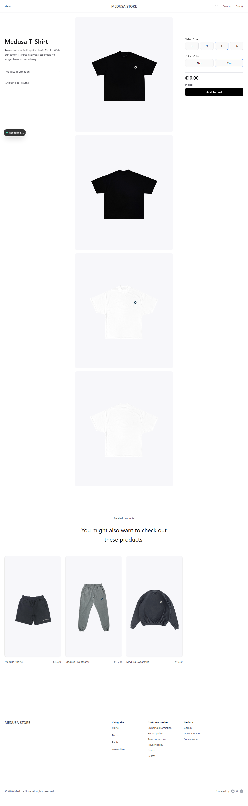

#### CP-CAT-02 — Selección de variantes (talla y color) y actualización de precio

#### CP-CAR-01 — Adición de producto al carrito y persistencia tras recarga

#### CP-CAR-02 — Eliminación de ítem del carrito y recálculo de subtotal

#### CP-CHK-01 — Flujo completo de checkout hasta confirmación de orden

#### CP-CHK-02 — Validación de campos obligatorios en dirección de envío

#### CP-CUS-01 — Consulta de historial de órdenes en perfil de cliente
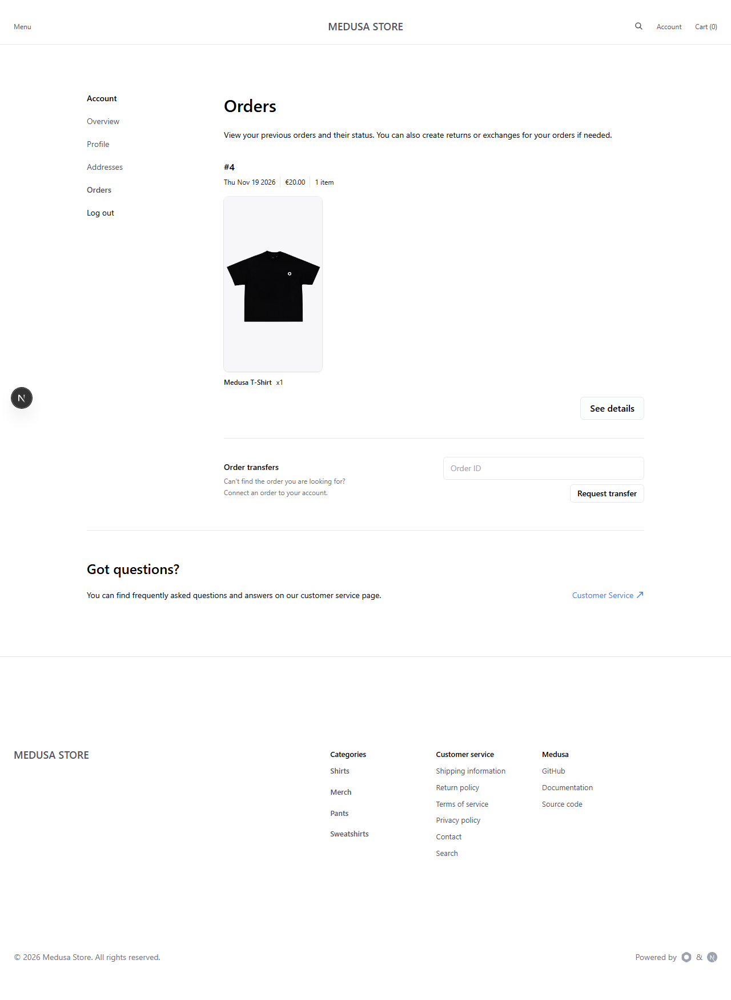

#### CP-CUS-02 — Registro y actualización de dirección de envío en perfil
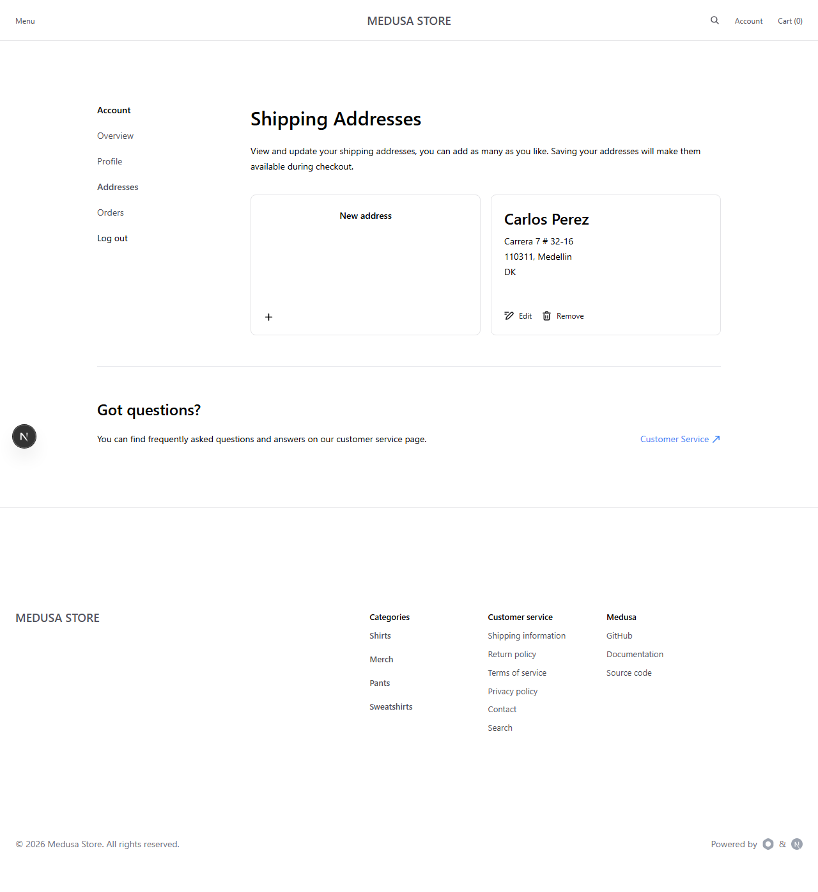

---

## 3. Evidencias de Medusa Admin (`http://localhost:9000/app`)

**Tabla 2**

*Registro de evidencias visuales de los nueve casos manuales ejecutados en Medusa Admin*

| ID del Caso | Historia | Escenario Evaluado | Archivos de Evidencia | Responsable | Estado |
| --- | --- | --- | --- | --- | :---: |
| `CP-AUTH-02` | `HU-02` | Inicio de sesión en dashboard administrativo y cierre de sesión hacia `/app/login` | `CP-AUTH-02-login-dashboard.png`, `CP-AUTH-02-logout.png` | Julián Cardona (QA — Ejecución Admin) | Pasó |
| `CP-PRD-01` | `HU-07` | Creación manual de producto (`Camiseta QA Manual 01`) con variante y precio `25.00 EUR` | `CP-PRD-01-form-variantes.png`, `CP-PRD-01-producto-creado.png` | Julián Cardona (QA — Ejecución Admin) | Pasó |
| `CP-PRD-02` | `HU-07` | Transición de estado `Draft -> Published` en Admin y visibilidad en Storefront | `CP-PRD-02-admin-published.png`, `CP-PRD-02-storefront-visible.png` | Julián Cardona (QA — Ejecución Admin) | Pasó |
| `CP-ORD-01` | `HU-08` | Visualización del detalle completo de orden creada desde Storefront | `CP-ORD-01-orden-detalle.png` | Julián Cardona (QA — Ejecución Admin) | Pasó |
| `CP-ORD-02` | `HU-08` | Registro de *fulfillment* de orden en el panel administrativo | `CP-ORD-02-fulfillment.png` | Julián Cardona (QA — Ejecución Admin) | Pasó |
| `CP-ORD-03` | `HU-08` | Cancelación controlada de orden pendiente en Admin | `CP-ORD-03-orden-cancelada.png` | Julián Cardona (QA — Ejecución Admin) | Pasó |
| `CP-INV-01` | `HU-09` | Ajuste manual de stock disponible (`50` unidades) por ubicación en Admin | `CP-INV-01-stock-50.png` | Julián Cardona (QA — Ejecución Admin) | Pasó |
| `CP-PRM-01` | `HU-10` | Creación manual de promoción porcentual (`QA10OFF`) en Admin | `CP-PRM-01-promocion-creada.png` | Julián Cardona (QA — Ejecución Admin) | Pasó |
| `CP-PRM-02` | `HU-10` | Cambio de estado `Active -> Inactive -> Active` de código promocional | `CP-PRM-02-inactiva.png`, `CP-PRM-02-promocion-estados.png` | Julián Cardona (QA — Ejecución Admin) | Pasó |

*Nota.* Fuente: Capturas obtenidas por Julián Cardona (QA — Ejecución Admin) durante la ejecución funcional en vivo sobre `http://localhost:9000/app` (trazabilidad en libro Excel y `casos-de-prueba/manuales/admin/`).

### 3.1 Galería de Capturas Admin

#### CP-AUTH-02 — Inicio y cierre de sesión de administrador en Admin

#### CP-PRD-01 — Creación manual de producto con variante y precio en Admin

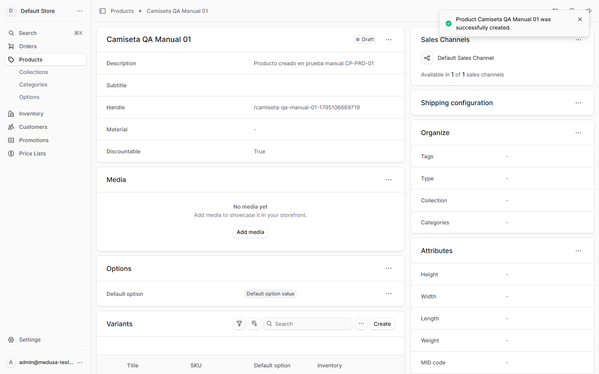

#### CP-PRD-02 — Cambio de estado de producto de borrador a publicado en Admin
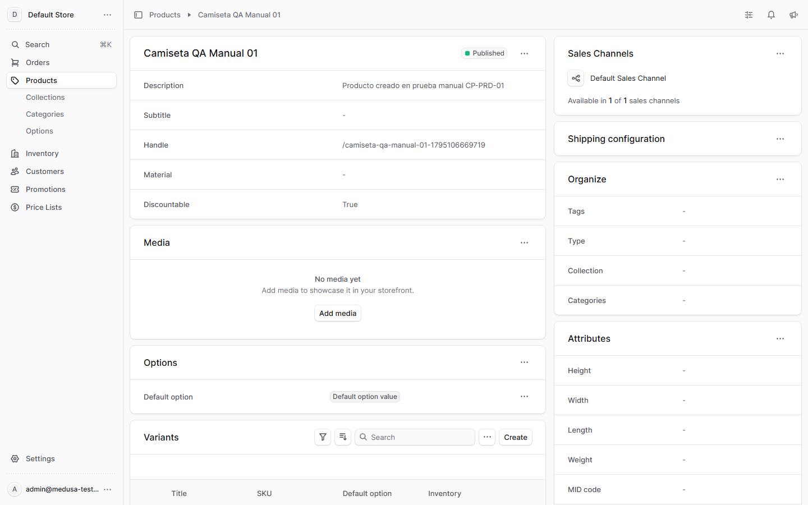

#### CP-ORD-01 — Visualización de detalle completo de orden creada en Storefront
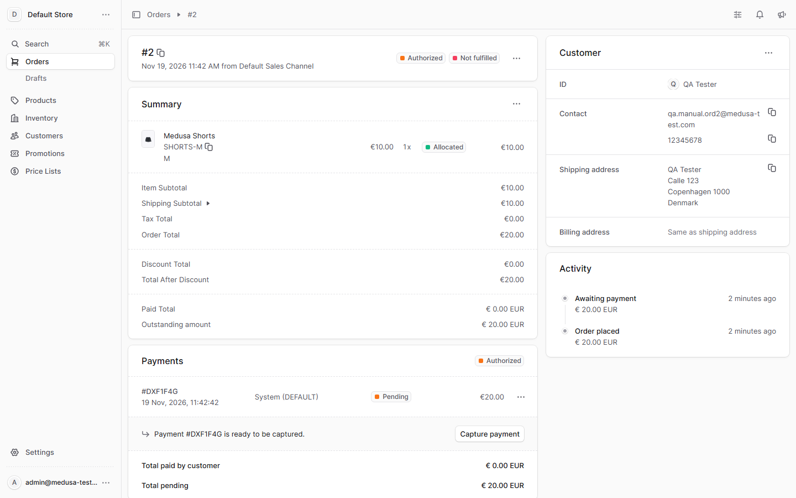

#### CP-ORD-02 — Registro de fulfillment parcial o total de orden en Admin
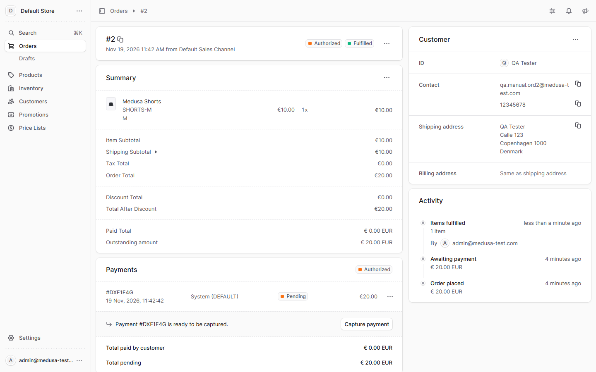

#### CP-ORD-03 — Cancelación controlada de orden pendiente en Admin
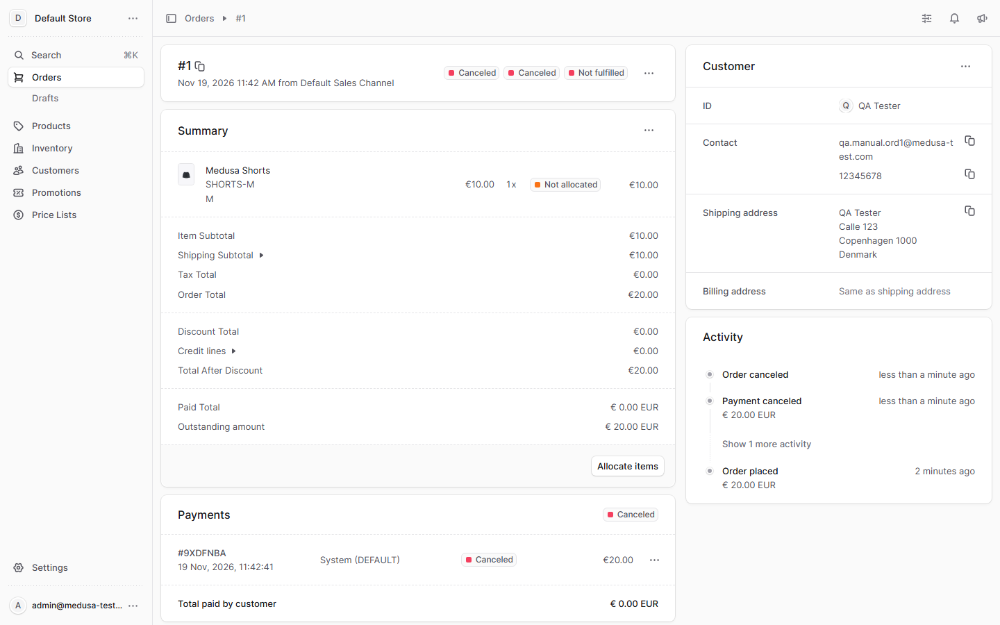

#### CP-INV-01 — Ajuste manual de stock disponible por ubicación en Admin
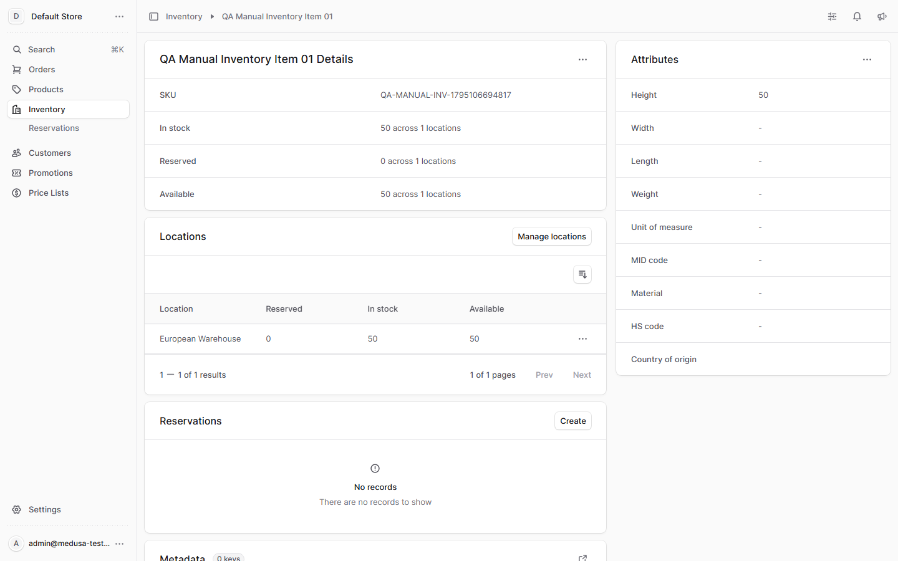

#### CP-PRM-01 — Creación manual de promoción porcentual en Admin
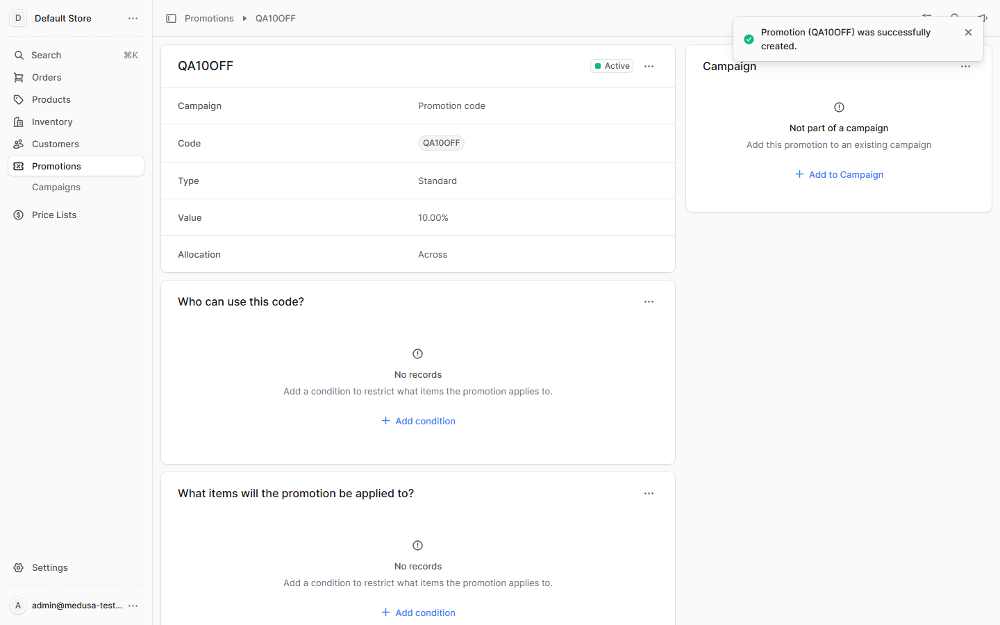

#### CP-PRM-02 — Activación y desactivación de código de descuento en Admin

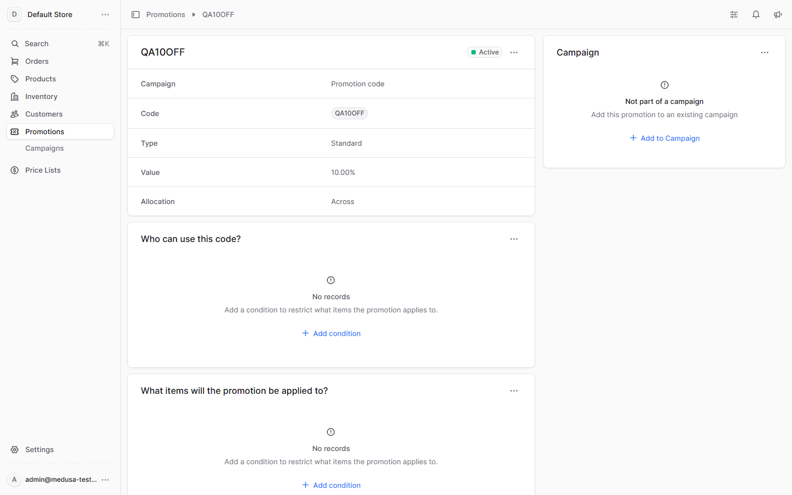

---

## 4. Evidencias de Defectos (`DEF-001` a `DEF-005` en GitHub Issues)

**Tabla 3**

*Registro de evidencias visuales de los cinco defectos reportados y cerrados por regresión*

| ID Defecto | Caso Asociado | Descripción del Hallazgo | Origen | Archivo de Evidencia | Issue GitHub | Estado |
| --- | --- | --- | --- | --- | :---: | :---: |
| `DEF-001` | `CP-AUTH-06` | Enlaces rotos (HTTP 404) de Política de Privacidad y Términos de Uso en registro | Hallazgo real | `evidencias/defectos/DEF-001-register-404.png` | [#46](https://github.com/JuanZ14-Dev/medusa-qa/issues/46) | Cerrado |
| `DEF-002` | `CP-CAR-06` | Opción duplicada (`value=1`) y colisión de `key={1}` en selector del carrito | Hallazgo real | `evidencias/defectos/DEF-002-cart-duplicate-qty.png` | [#47](https://github.com/JuanZ14-Dev/medusa-qa/issues/47) | Cerrado |
| `DEF-003` | `CP-CHK-07`, `CP-CHK-08` | Compresión responsiva en checkout móvil (`375x812`) y sin validación telefónica | Hallazgo real | `evidencias/defectos/DEF-003-mobile-checkout-375x812.png` | [#48](https://github.com/JuanZ14-Dev/medusa-qa/issues/48) | Cerrado |
| `DEF-004` | `CP-CHK-09` | Total de orden en resumen omite envío e impuestos (`item_subtotal`) | Inyección controlada | `evidencias/defectos/DEF-004-critical-total-mismatch.png` | [#49](https://github.com/JuanZ14-Dev/medusa-qa/issues/49) | Cerrado |
| `DEF-005` | `CP-INV-05` | Botón `Add to cart` habilitado en Storefront para variantes con stock cero | Inyección controlada | `evidencias/defectos/DEF-005-out-of-stock-enabled.png` | [#50](https://github.com/JuanZ14-Dev/medusa-qa/issues/50) | Cerrado |

*Nota.* Fuente: Capturas obtenidas en vivo con Playwright (desktop `1440x900` y móvil `375x812`) por Julián Cardona durante la inspección y ejecución de regresión del 23/11/2026. GitHub Issues gestiona exclusivamente estos cinco defectos (`DEF-001` a `DEF-005`).

### 4.1 Galería de Capturas de Defectos

#### DEF-001 — Enlaces rotos de Política de Privacidad y Términos de Uso

#### DEF-002 — Opción duplicada de cantidad en selector del carrito
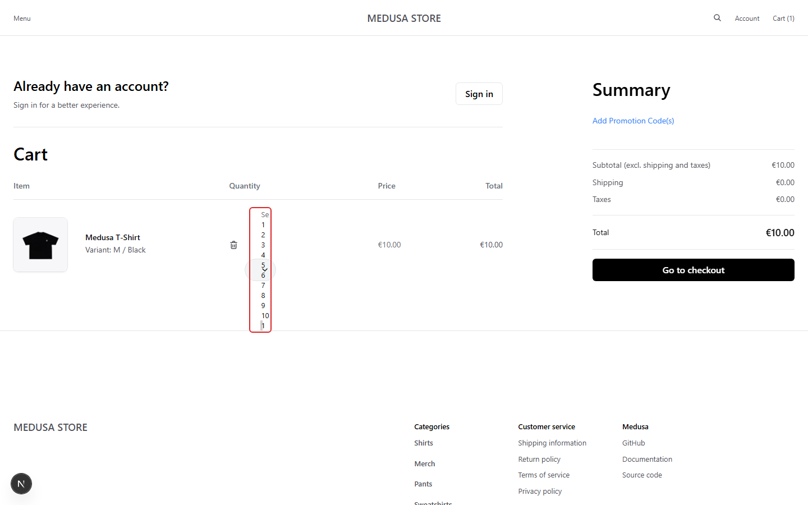

#### DEF-003 — Compresión responsiva en checkout móvil (375x812)
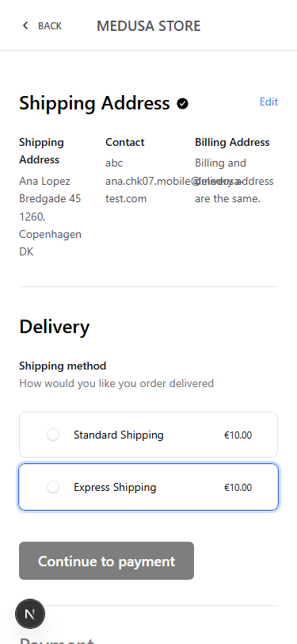

#### DEF-004 — Total de orden omite envío e impuestos (Inyección controlada)
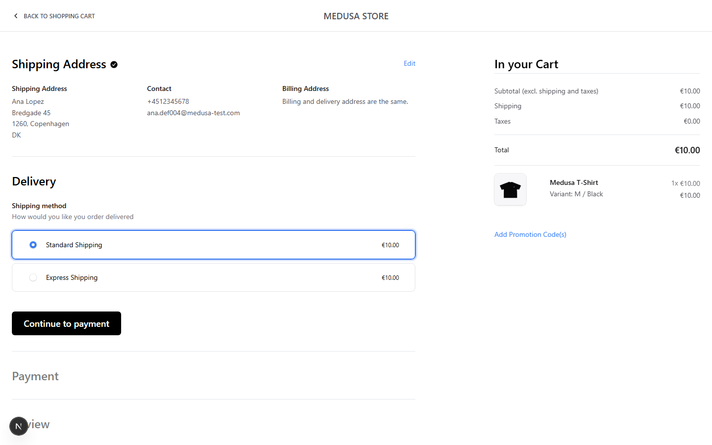

#### DEF-005 — Botón Add to cart habilitado con stock cero (Inyección controlada)
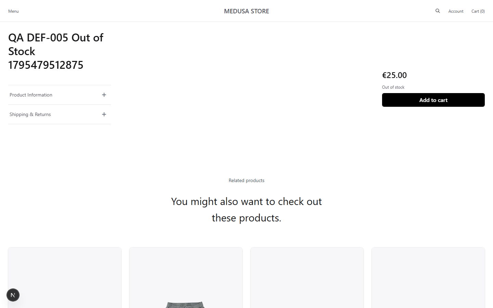
