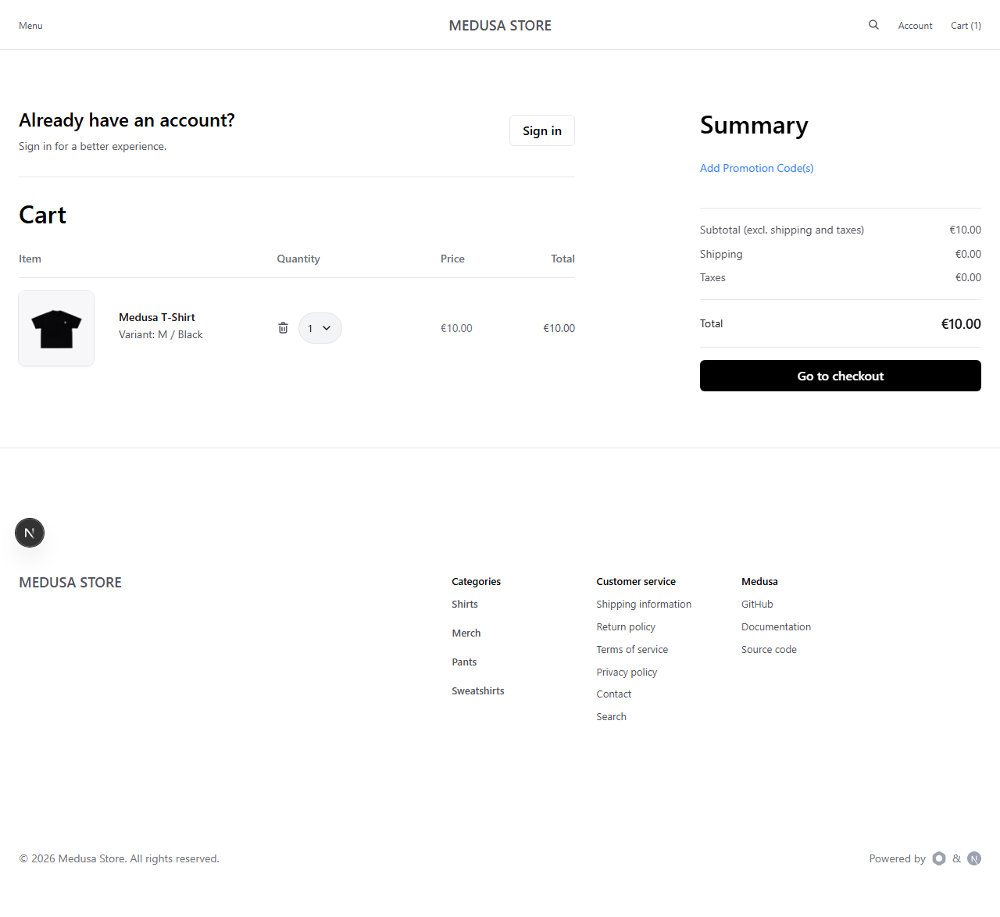
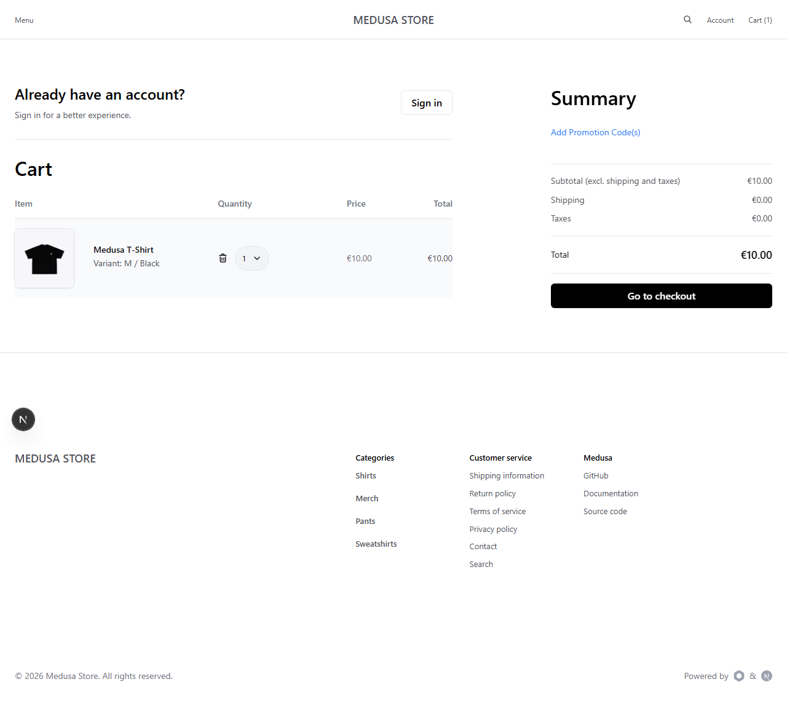
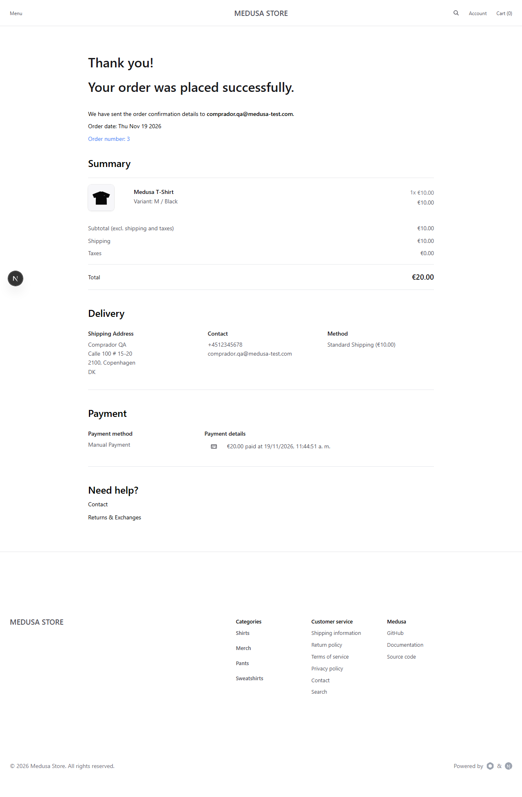
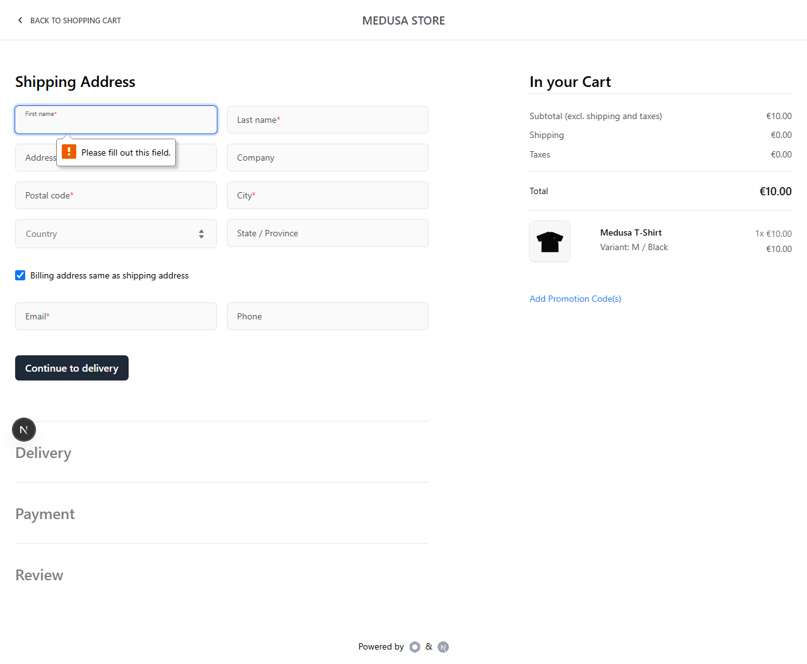
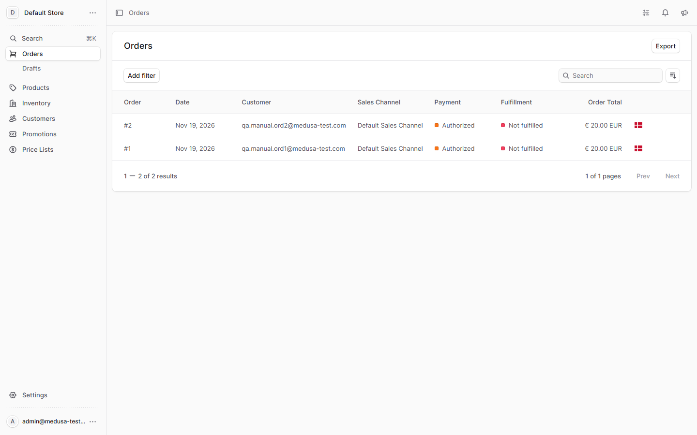
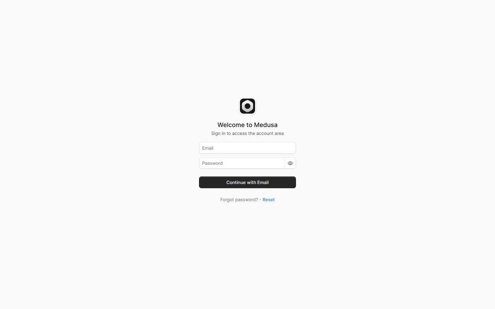
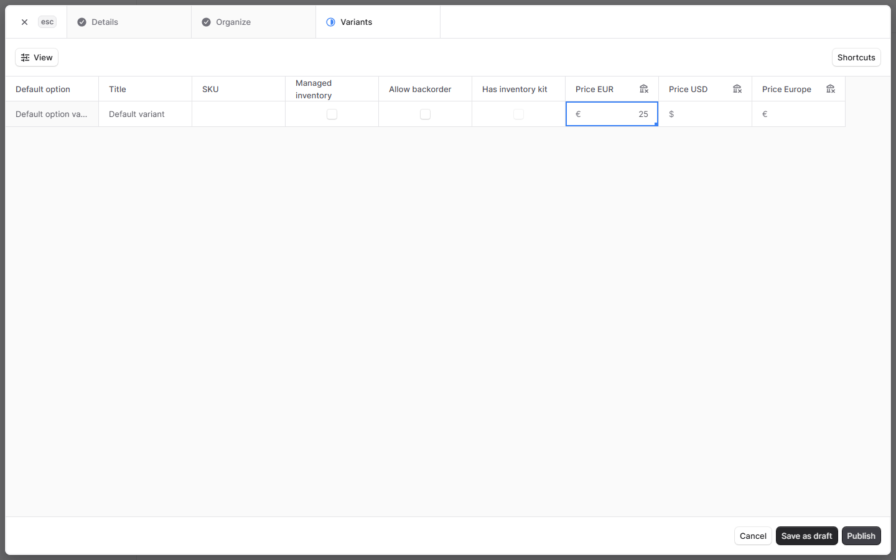
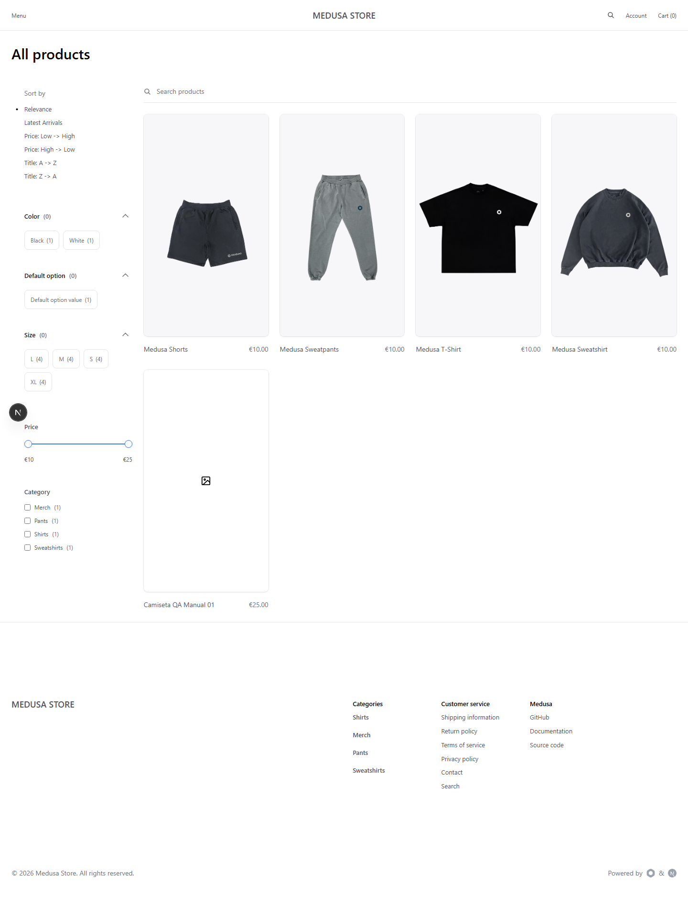
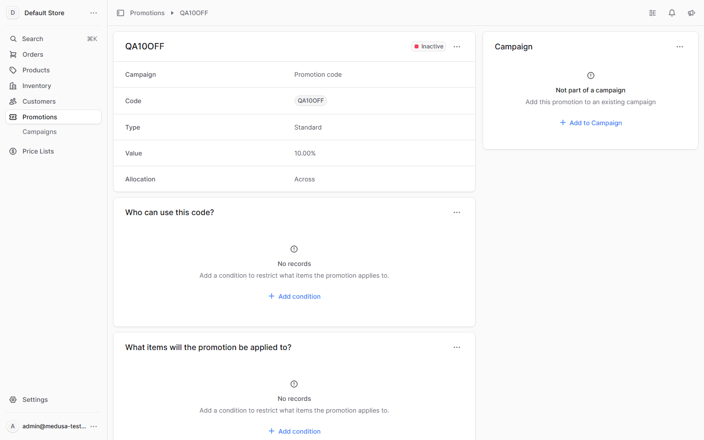

# Catálogo de Evidencias Visuales de Ejecución Manual (Storefront y Admin)

## 1. Propósito del Catálogo Documental

El presente anexo consolida las **22 capturas de pantalla reales** recolectadas durante la ejecución de los **18 casos de prueba manuales** (9 en Medusa Storefront y 9 en Medusa Admin) el 19 de noviembre de 2026. Cada evidencia visual respalda el resultado obtenido registrado en las fichas de 16 campos ubicadas en `casos-de-prueba/manuales/` y en los GitHub Issues correspondientes del repositorio `JuanZ14-Dev/medusa-qa`.

---

## 2. Evidencias de Medusa Storefront (`http://localhost:8000`)

**Tabla 1**

*Registro de evidencias visuales de los nueve casos manuales ejecutados en Storefront*

| ID del Caso | Historia | Escenario Evaluado | Archivo de Evidencia | Issue GitHub | Estado |
| --- | --- | --- | --- | :---: | :---: |
| `CP-AUTH-01` | `HU-01` | Registro exitoso de nuevo cliente (`Laura Gomez`) y redirección a `/dk/account` | `evidencias/storefront/CP-AUTH-01.png` | [#1](https://github.com/JuanZ14-Dev/medusa-qa/issues/1) | Pasó |
| `CP-CAT-01` | `HU-03` | Navegación y visualización de detalle de producto en Storefront | `evidencias/storefront/CP-CAT-01.png` | [#6](https://github.com/JuanZ14-Dev/medusa-qa/issues/6) | Pasó |
| `CP-CAT-02` | `HU-03` | Selección de variantes (talla y color) y actualización dinámica de precio | `evidencias/storefront/CP-CAT-02.png` | [#7](https://github.com/JuanZ14-Dev/medusa-qa/issues/7) | Pasó |
| `CP-CAR-01` | `HU-04` | Adición de producto al carrito y persistencia de sesión tras recarga | `evidencias/storefront/CP-CAR-01.png` | [#11](https://github.com/JuanZ14-Dev/medusa-qa/issues/11) | Pasó |
| `CP-CAR-02` | `HU-04` | Eliminación de ítem del carrito y recálculo de subtotal a cero | `evidencias/storefront/CP-CAR-02.png` | [#12](https://github.com/JuanZ14-Dev/medusa-qa/issues/12) | Pasó |
| `CP-CHK-01` | `HU-05` | Flujo completo de checkout hasta pantalla de confirmación de orden | `evidencias/storefront/CP-CHK-01.png` | [#16](https://github.com/JuanZ14-Dev/medusa-qa/issues/16) | Pasó |
| `CP-CHK-02` | `HU-05` | Validación de campos obligatorios vacíos en formulario de dirección de envío | `evidencias/storefront/CP-CHK-02.png` | [#17](https://github.com/JuanZ14-Dev/medusa-qa/issues/17) | Pasó |
| `CP-CUS-01` | `HU-06` | Consulta de historial de órdenes confirmadas en el perfil del cliente | `evidencias/storefront/CP-CUS-01.png` | [#22](https://github.com/JuanZ14-Dev/medusa-qa/issues/22) | Pasó |
| `CP-CUS-02` | `HU-06` | Registro y actualización de dirección de envío en libreta del cliente | `evidencias/storefront/CP-CUS-02.png` | [#23](https://github.com/JuanZ14-Dev/medusa-qa/issues/23) | Pasó |

*Nota.* Fuente: Capturas obtenidas durante la Oleada 3A (`SA-04`) sobre `http://localhost:8000`.

### 2.1 Galería de Capturas Storefront

#### CP-AUTH-01 — Registro exitoso de nuevo cliente en Storefront

#### CP-CAT-01 — Navegación y visualización de detalle de producto en Storefront

#### CP-CAT-02 — Selección de variantes (talla y color) y actualización de precio

#### CP-CAR-01 — Adición de producto al carrito y persistencia tras recarga

#### CP-CAR-02 — Eliminación de ítem del carrito y recálculo de subtotal

#### CP-CHK-01 — Flujo completo de checkout hasta confirmación de orden

#### CP-CHK-02 — Validación de campos obligatorios en dirección de envío

#### CP-CUS-01 — Consulta de historial de órdenes en perfil de cliente

#### CP-CUS-02 — Registro y actualización de dirección de envío en perfil

---

## 3. Evidencias de Medusa Admin (`http://localhost:9000/app`)

**Tabla 2**

*Registro de evidencias visuales de los nueve casos manuales ejecutados en Medusa Admin*

| ID del Caso | Historia | Escenario Evaluado | Archivos de Evidencia | Issue GitHub | Estado |
| --- | --- | --- | --- | :---: | :---: |
| `CP-AUTH-02` | `HU-02` | Inicio de sesión en dashboard administrativo y cierre de sesión hacia `/app/login` | `CP-AUTH-02-login-dashboard.png`, `CP-AUTH-02-logout.png` | [#2](https://github.com/JuanZ14-Dev/medusa-qa/issues/2) | Pasó |
| `CP-PRD-01` | `HU-07` | Creación manual de producto (`Camiseta QA Manual 01`) con variante y precio `25.00 EUR` | `CP-PRD-01-form-variantes.png`, `CP-PRD-01-producto-creado.png` | [#26](https://github.com/JuanZ14-Dev/medusa-qa/issues/26) | Pasó |
| `CP-PRD-02` | `HU-07` | Transición de estado `Draft -> Published` en Admin y visibilidad en Storefront | `CP-PRD-02-admin-published.png`, `CP-PRD-02-storefront-visible.png` | [#27](https://github.com/JuanZ14-Dev/medusa-qa/issues/27) | Pasó |
| `CP-ORD-01` | `HU-08` | Visualización del detalle completo de orden creada desde Storefront | `CP-ORD-01-orden-detalle.png` | [#32](https://github.com/JuanZ14-Dev/medusa-qa/issues/32) | Pasó |
| `CP-ORD-02` | `HU-08` | Registro de *fulfillment* de orden en el panel administrativo | `CP-ORD-02-fulfillment.png` | [#33](https://github.com/JuanZ14-Dev/medusa-qa/issues/33) | Pasó |
| `CP-ORD-03` | `HU-08` | Cancelación controlada de orden pendiente en Admin | `CP-ORD-03-orden-cancelada.png` | [#34](https://github.com/JuanZ14-Dev/medusa-qa/issues/34) | Pasó |
| `CP-INV-01` | `HU-09` | Ajuste manual de stock disponible (`50` unidades) por ubicación en Admin | `CP-INV-01-stock-50.png` | [#38](https://github.com/JuanZ14-Dev/medusa-qa/issues/38) | Pasó |
| `CP-PRM-01` | `HU-10` | Creación manual de promoción porcentual (`QA10OFF`) en Admin | `CP-PRM-01-promocion-creada.png` | [#42](https://github.com/JuanZ14-Dev/medusa-qa/issues/42) | Pasó |
| `CP-PRM-02` | `HU-10` | Cambio de estado `Active -> Inactive -> Active` de código promocional | `CP-PRM-02-inactiva.png`, `CP-PRM-02-promocion-estados.png` | [#43](https://github.com/JuanZ14-Dev/medusa-qa/issues/43) | Pasó |

*Nota.* Fuente: Capturas obtenidas durante la Oleada 3B (`SA-05`) sobre `http://localhost:9000/app`.

### 3.1 Galería de Capturas Admin

#### CP-AUTH-02 — Inicio y cierre de sesión de administrador en Admin

#### CP-PRD-01 — Creación manual de producto con variante y precio en Admin

#### CP-PRD-02 — Cambio de estado de producto de borrador a publicado en Admin

#### CP-ORD-01 — Visualización de detalle completo de orden creada en Storefront

#### CP-ORD-02 — Registro de fulfillment parcial o total de orden en Admin

#### CP-ORD-03 — Cancelación controlada de orden pendiente en Admin

#### CP-INV-01 — Ajuste manual de stock disponible por ubicación en Admin

#### CP-PRM-01 — Creación manual de promoción porcentual en Admin

#### CP-PRM-02 — Activación y desactivación de código de descuento en Admin

